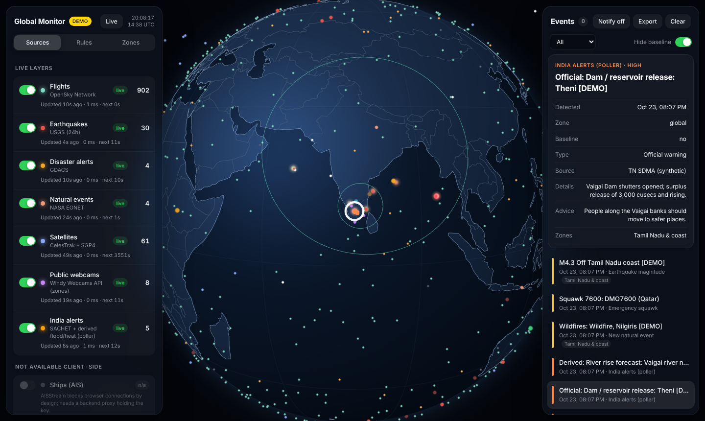

# OSI — Global Monitor

A real-time open-source-intelligence (OSINT) globe plus a scheduled alert poller for Indian disaster warnings. It surfaces **what changed that matters**, from official warnings and model forecasts, and tells you when it stops working.



It has two parts:

- **Dashboard** (`index.html`, `src/`): a static page with a 3D globe, live layers, a rule engine and an event feed.
- **Poller** (`poller/`): runs on GitHub Actions every 15 minutes, works with the dashboard closed, and sends Telegram alerts.

**Live dashboard:** https://mohinsoundravel.github.io/OSI/ (GitHub Pages)

See [DESIGN.md](DESIGN.md) for architecture, efficiency and safety decisions.

## What it monitors

| Layer | Source | Where | Refresh |
|---|---|---|---|
| Official warnings: flood, heat wave, dam / reservoir release, cyclone, heavy rain | NDMA [SACHET](https://sachet.ndma.gov.in) CAP feed (IMD, state authorities, INCOIS) | Poller | 30 min |
| River-rise forecast (derived), 12 points on major Tamil Nadu rivers | GloFAS via [Open-Meteo](https://open-meteo.com/en/docs/flood-api) | Poller | 15 min |
| Reservoir levels and dam releases (derived from official daily figures), 19 dams: Mettur, Bhavanisagar, Vaigai, Periyar, Papanasam, Sathanur and others, plus Karnataka's KRS, Kabini, Harangi and Hemavathy that feed Mettur | [TN Agriculture Dept](https://tnagriculture.in/people_app/more/reservoir/en/) (WRD data) | Poller | hourly (data is daily) |
| Rain forecast per district (derived, IMD 24-hour categories), 56 districts of Tamil Nadu, Puducherry and neighbours | [Open-Meteo](https://open-meteo.com) forecast | Poller | hourly |
| Heat wave forecast (derived, IMD criteria), 20 stations across Tamil Nadu | [Open-Meteo](https://open-meteo.com) forecast | Poller | 15 min |
| Disaster alerts | [GDACS](https://www.gdacs.org) | Both | 5–15 min |
| Earthquakes | [USGS](https://earthquake.usgs.gov/earthquakes/feed/) | Both | 2–15 min |
| Flights (incl. emergency squawks) | [OpenSky Network](https://opensky-network.org) via the poller (OpenSky blocks browsers on other sites) | Both | 30 min snapshot, projected along track every 5 s |
| Ships (AIS), Arabian Sea, Bay of Bengal and around Sri Lanka | [AISStream.io](https://aisstream.io) via the poller (needs the `AISSTREAM_API_KEY` secret) | Both | 45 s listen per poll, projected along course every 5 s |
| Natural events | [NASA EONET](https://eonet.gsfc.nasa.gov) | Dashboard | 5 min |
| Satellites: every active satellite (about 16,000, incl. Starlink, OneWeb, GNSS, ISRO) | [CelesTrak](https://celestrak.org) via the poller (SatNOGS, then AMSAT as fallbacks) + SGP4 | Both | positions every 10 s in a background worker, interpolated every frame |
| Cyclones in the North Indian Ocean: track, forecast track, uncertainty cone, 120 km/h wind swath, estimated landfall and closest approach to the Tamil Nadu coast | [GDACS](https://www.gdacs.org) (JTWC forecasts) via the poller | Both | list every 15 min; geometry per advisory |
| Sea state at 11 points off the Tamil Nadu coast (WMO categories) | [Open-Meteo Marine](https://open-meteo.com/en/docs/marine-weather-api) via the poller | Both | hourly |
| Fire hotspots across South Asia, 24 h; alerts for 8 Tamil Nadu forest areas | [NASA FIRMS](https://firms.modaps.eosdis.nasa.gov) VIIRS (NOAA-20, NOAA-21, S-NPP) via the poller | Both | hourly |
| News headlines from Indian sources, placed by the town or state they name (unverified; never an alert) | [GDELT](https://www.gdeltproject.org) DOC 2.0 via the poller | Both | hourly, last 48 h |
| Live streams | Official Tamil news channels on YouTube (Thanthi TV, Puthiya Thalaimurai, Polimer News); NASA live from the ISS card | Dashboard | tap to play |
| Public webcams | [Windy Webcams API](https://api.windy.com/webcams) (owner-published only) | Dashboard | 9 min |

Every alert is labelled **Official** or **Derived (not an official warning)** and links to its source.

### Dashboard features

- **Home-screen app**: add it from the browser menu for a full-screen app that opens with the last known data offline (service worker: app files and data network-first, map tiles cached).
- **Long-press** (right-click on desktop) anywhere: nearest district, dam and river point, district rain forecast, alerts within 75 km, current weather and elevation.
- **Private watch spots**: add from the long-press card; stored only in this browser, drawn as rings, summarised in the brief, with a pop-up when an alert falls inside one.
- **Telegram**: urgent alerts as they happen; a **morning digest at 07:00 IST** (overnight alerts, cyclones, dams, rain, sea, fires, headlines); on **Sunday** a weekly alert review and a link to the **weekly India disaster brief** (Markdown on the `data` branch, `briefs/`). Commands, answered by the next poll (within about 15 minutes), owner chat only: `/status`, `/alerts`, `/dams`, `/rain`, `/digest`, `/review`, `/brief`, `/mute <group> [days]`, `/unmute <group>`, `/muted`, `/help`.
- **Alert feedback**: tap **Useful** or **Noise** under an alert. The weekly review counts alerts per rule with their ratings and, for rules mostly rated noise, names the config setting to change (or the `/mute` command). `ruleOverrides` in `config/monitor.json` caps notifications per rule; held-back alerts are still recorded and shown on the dashboard.
- **Situation brief** at the top of the feed: "Tamil Nadu now", with the most severe alerts, dams near full or rising fast, big inflows, the strongest river-rise forecast, the hottest forecast, cyclones (closest approach and landfall), rough sea, fire hotspots, local headlines, quakes and ships in distress, plus the data's age. Tap a line to fly to it.
- **One-tap views**: TN Watch (Tamil Nadu: alerts, cyclones, sea, fires, news, ships, radar), Air & Sea (flights, ships, satellites) and Global.
- **Radar loop**: "Play last hour" animates six 10-minute RainViewer frames at regional detail (kept under the free rate limit).
- **Trend charts** in the detail panel: dam level against full depth with daily inflow (history kept by the poller and backfilled 30 days), river discharge 7 days back and ahead with today marked, and the temperature forecast against the IMD threshold.
- **Place search**: districts, dams, river points, heat stations and typed coordinates ("11.0, 78.6") instantly; "Search places worldwide" asks OpenStreetMap once per tap.
- **Alert pop-ups**: bursts merge into one, tap to open the alert or feed, swipe to dismiss; on phones they sit above the chips, clear of search and map buttons.
- **Legend** for whatever is on screen: RainViewer's official dBZ colours, NASA's own legend images for rain and clouds, ship, flight, quake, GDACS and alert colours.
- **Google Earth-style imagery**: satellite tiles stream in sharper as you zoom, from the whole planet down to about 500 m eye altitude (street level, zoom 18). Three styles: **Hybrid** (imagery with roads, borders and place names), **Satellite** (imagery only) and **Dark** (Esri dark gray map). Double tap or double click zooms in on a spot; the bottom line shows eye altitude and coordinates. If imagery cannot be reached, the globe falls back to offline outlines.
- **NASA today** style: yesterday's or today's real satellite photo of the whole planet (NASA VIIRS, 375 m), useful for seeing cyclones, smoke and flood extent.
- **Weather overlay** (button under the style button): **Radar** (RainViewer, every 10 min; IMD radars at Chennai, Karaikal, Kochi, Thiruvananthapuram), **Rain** (NASA GPM IMERG satellite estimate, global, about 5 h behind) and **Clouds** (Himawari-9 infrared, about 30 min behind, only cloud pixels shown). The button shows the frame time.
- **Icons per layer** rendered on the GPU: aircraft point along their real heading; satellites, quake rings sized by magnitude, cyclone, flood, fire, volcano, dam, heat and camera symbols.
- **Smart tags** such as `AIC302 · FL350 · 812 km/h` or `ISS · 420 km`, prioritised (alerts, selection, notable events first; flights once zoomed in) with overlap avoidance.
- **Hover** (desktop) and **tap** for details; **orbit path** for a selected satellite and a **30-minute projected track** for a selected flight.
- **Day/night shading** from the real sun position.
- **Search** (`/` on desktop) for callsigns, satellites, districts and events, with fly-to.
- **Layer chips**, a **status pill** (alerts and live sources), and on phones a **draggable bottom sheet** that snaps to half or full height.

**Dam releases:** India has no public machine-readable dam-release feed. The poller detects releases from SACHET alert text and models river rise below dams. Coverage is partial; see [DESIGN.md](DESIGN.md#dam-releases).

## Setting up the poller

The **Monitor** workflow runs on its own once this repo is on GitHub. Without secrets it still runs, records alerts and publishes data, but sends nothing. To receive alerts:

1. **Telegram bot**: message [@BotFather](https://t.me/BotFather), send `/newbot`, and copy the token. Send your new bot any message, then open `https://api.telegram.org/bot<TOKEN>/getUpdates` and copy `chat.id`.
2. **Dead-man's switch**: create a free check at [healthchecks.io](https://healthchecks.io) with a 30-minute period and 1-hour grace, and copy its ping URL. It alerts you if the poller stops running for any reason.
3. In the repo: **Settings → Secrets and variables → Actions → New repository secret**:
   - `TELEGRAM_BOT_TOKEN`
   - `TELEGRAM_CHAT_ID`
   - `HEALTHCHECK_URL`
   - `MONITOR_CONFIG_JSON` (optional: overrides `config/monitor.json`, useful if the repo is public)
4. **Actions → Monitor → Run workflow**, task `build-normals`, once. This builds 1991–2020 temperature baselines so the heat rule can use IMD's departure-from-normal criteria.
5. **Actions → Monitor → Run workflow**, task `poll`, to confirm. The first run sends a single "monitor started" summary; after that only new or escalated alerts are sent.

Edit `config/monitor.json` to change watch zones, river points, heat points and thresholds. If you know a river's official warning or danger discharge, add `warningDischarge` / `dangerDischarge` (m³/s) to that point.

## Running the dashboard

It is a static site with no build step:

```bash
git clone https://github.com/mohinsoundravel/OSI.git
cd OSI
npm run serve          # python3 -m http.server 8080
# open http://localhost:8080
```

- **Demo mode**: click **Demo** in the header (or open `/#demo`) for a scripted scenario of synthetic events, including a dam release and a heat wave. Demo data uses isolated storage and is clearly labelled.
- **India alerts layer**: on GitHub Pages it reads the `data` branch automatically from `raw.githubusercontent.com`. Elsewhere, set **Poller data URL** in the Sources tab.

### GitHub Pages

CI publishes the site to the `site` branch only after the tests and the browser test pass, so a broken dashboard never goes live. One-time setup: **Settings → Pages → Build and deployment → Deploy from a branch → `site` / `(root)` → Save**. (Serving `main` directly still works, but skips that gate.)

## Development

Node 20+ and no dependencies.

```bash
npm test               # unit + end-to-end tests against fixtures
npm run check          # syntax, cross-module imports, offline-cache list, config
npm run test:browser   # headless Chrome against fixture data, every outside host blocked
npm run poll:fixtures  # full poller run against fixtures, no network, no messages
```

CI runs all three on every push. The browser test uses the Chrome preinstalled on GitHub's runners (locally: any Chrome or Chromium, or set `CHROME_PATH`).

## Project structure

```
index.html                 Markup and CSP (scripts from this site only)
src/main.js                Entry: starts the app modules once three.js is loaded
src/app/                   Dashboard ES modules: core, layers, fetchers, satellites, hazards,
                           globe, tiles, weather, icons, camera, tags, rules, scheduler, boot
src/app/ui/                Panels: detail, charts, feed, sources, rules, zones, brief, views, search
src/app/app-state.js       The few UI values several modules change
src/sat-worker.js          Satellite propagation off the main thread
src/vendor/                three.js, satellite.js, topojson-client, world-atlas (pinned, hashed)
src/styles.css             Glass UI, animations, responsive bottom sheets
sw.js                      Offline cache (scripts/check-syntax.mjs keeps its file list complete)
poller/index.mjs           Poller entry: fetch, rules, de-duplicate, notify, publish
poller/sources/            SACHET, Open-Meteo (flood, heat, rain, marine), GDACS (events, cyclones),
                           USGS, reservoirs, flights, ships, satellites, FIRMS fires, GDELT news
poller/rules.mjs           Alert rules (official vs derived)
poller/notify.mjs          Telegram messages, feedback buttons, heartbeat
poller/commands.mjs        Telegram commands and button taps
poller/feedback.mjs        Mutes, rule overrides, feedback and the weekly review
poller/digest.mjs          Morning digest, daily log and the weekly brief
poller/lib/                Safe XML, allowlisted HTTP, WebSocket client, geometry, gazetteer
poller/data/               District and India place gazetteers
poller/test/               node:test suites and fixtures
scripts/                   Static checks and the browser test
config/monitor.json        Zones, points, thresholds, digest time, rule overrides
.github/workflows/         CI (tests, browser test, site publish) and the scheduled Monitor
```

## Known limits

- **15-minute polling** plus possible GitHub delays: suited to hazards that develop over hours, not minutes.
- **SACHET locations are district-level.** SACHET's polygon files are blocked to automated clients, so alerts are placed by district name. See [DESIGN.md](DESIGN.md#locating-sachet-alerts).
- **Diagnosing a broken source:** run the Monitor workflow with task `diagnose`; raw responses land on the `diagnostics` branch.
- **Actions minutes** are free on public repositories. If the repo is made private again, switch the schedule back to every 30 minutes (see the comment in `monitor.yml`) to stay within GitHub Free's 2,000 minutes.
- **Heat-wave baselines** build gradually (Open-Meteo's free limit allows about a dozen 30-year downloads a day); stations without one use IMD's absolute 45 °C rule until it arrives. A daily job fills them in.
- **Imagery** comes from Esri World Imagery (dates and sharpness vary by place; some rural areas stop at a coarser zoom or show "Map data not yet available") and Esri's dark gray canvas (detail to zoom 16). There is no 3D terrain, no 3D buildings and no camera tilt yet: Google's photorealistic 3D tiles need a billed Google Maps key.
- **Reservoir limits**: one figure per dam per day, from a single state web page; if its layout changes the source fails loudly (degraded notice) rather than guessing. Release thresholds are per-dam estimates, set above routine irrigation releases. Alerts: large release (high/critical), a jump of 5,000+ cusecs and 50% in a day (medium, the usual sign of gates opening), within 3 ft of full (medium) or 0.5 ft (high).
- **Cameras**: only owner-published feeds. Windy webcams need a free key (Controls, Sources) and are mostly daylight timelapses, not live video. YouTube pins play only while the channel is live. Players load only when tapped, from URLs built from validated IDs, in sandboxed frames.
- **Weather overlay limits**: radar exists only near radars and stops sharpening beyond zoom 7 (RainViewer's free tier, personal use, 100 requests a minute); IMERG is hours old, so it shows where it rained, not where it is raining; Himawari sees India near the edge of its view, so shapes over western India are stretched.
- **Ships (AIS)**: AISStream uses volunteer coastal receivers, so coverage is good near receivers and thin or absent in open sea; there is no satellite AIS. Each poll listens for 45 seconds and keeps ships heard in the last 3 hours, so slow or anchored ships appear after a few polls.
- **Cyclone forecasts** are JTWC tracks as republished by GDACS, not IMD's; landfall is where the forecast track crosses a simplified coastline (about 40 points), so treat the place and time as indicative.
- **Fire hotspots** are thermal anomalies: in late October most of South Asia's are crop-residue burning in the north-west. Alerts are limited to eight forest areas in Tamil Nadu.
- **News** is machine-collected: GDELT's coverage, its tagging and the place named in a headline decide what appears. Headlines that name no known Indian place are dropped. GDELT also rate-limits shared addresses such as GitHub's runners, so the layer can lag by an hour.
- **Not a primary warning system.** Keep the official SACHET app and cell-broadcast alerts enabled.

## Data usage and ethics

Only intentionally public feeds are used. The webcam layer lists cameras their owners chose to publish; it never discovers or accesses unsecured private cameras. The poller identifies itself with a User-Agent, polls government sites no more than twice an hour, and respects provider terms. Windy, Open-Meteo, Esri, RainViewer and NASA GIBS require or request attribution, which the dashboard and messages provide.
